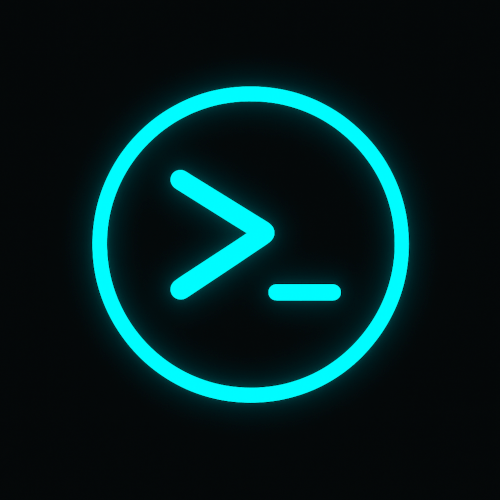
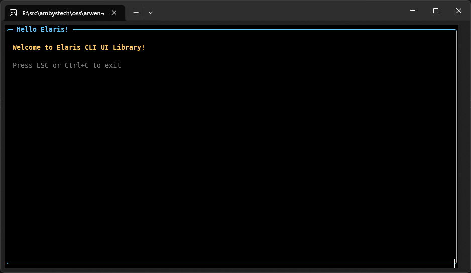
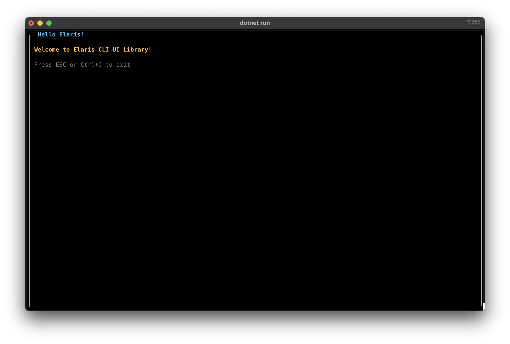

# Ambystech.Elaris.UI



[](https://www.nuget.org/packages/Ambystech.Elaris.UI/)
[](https://opensource.org/licenses/MIT)
=======================
A lightweight Terminal UI library for .NET with true 24-bit RGB color support. Built for modern terminals with cross-platform support.

## Features

- **True 24-bit RGB Color**: Full truecolor support via ANSI escape sequences
- **Zero Dependencies**: Pure .NET implementation with no external packages
- **Cross-Platform**: Works on Windows, macOS, and Linux
- **Modern Architecture**: Clean, extensible widget-based design
- **High Performance**: Double-buffered rendering with minimal overhead
- **Multi-Target**: Supports .NET 8.0, .NET 9.0, and .NET 10.0

## Quick Start

### Installation

```bash
dotnet add package Ambystech.Elaris.UI
```

### Basic Usage

```csharp
using Ambystech.Elaris.UI;
using Ambystech.Elaris.UI.Core;
using Ambystech.Elaris.UI.Enums;
using Ambystech.Elaris.UI.Widgets.Display;
using Ambystech.Elaris.UI.Widgets.Layout;

// Create application
var app = new Application();

// Create the root frame (it fills the terminal)
var frame = new Frame("Hello Elaris")
{
    BorderStyle = BorderStyle.Rounded,
    ForegroundColor = ColorHelper.FromRgb(100, 200, 255)
};

// Add widgets
var label = new Label("Welcome to Elaris!")
{
    X = 2,
    Y = 2,
    Width = 40,
    Height = 1,
    ForegroundColor = ColorHelper.FromRgb(255, 200, 100)
};
frame.Add(label);

// Run application (press Esc or Ctrl+C to exit)
app.Run(frame);
```

### Keyboard

| Key | Action |
|---|---|
| `Alt+→` / `Alt+←` | Move focus to the next / previous widget |
| `Esc` | Quit, unless the focused widget uses it (e.g. to close a menu). Change with `app.QuitKey`, or set it to `null` to disable |
| `Ctrl+C` | Quit (disable with `app.QuitOnCtrlC = false`) |

The terminal is restored on exit, including on Ctrl+C, process termination and unhandled exceptions.

### Cross Platform Compatibility

Elaris.UI is designed to work seamlessly across Windows, macOS, and Linux terminals that support ANSI escape codes. Ensure your terminal supports truecolor for the best experience.

#### Windows Terminal



#### iTerm2 (macOS)


## Layout and Clipping

Widget positions (`X`, `Y`) are absolute screen coordinates. To keep children inside a frame that is itself positioned by a layout, let the frame lay them out (`Frame` is a `Container`):

```csharp
var frame = new Frame("Details") { LayoutMode = LayoutMode.Vertical, Padding = 1, Height = 6 };
frame.Add(new Label("Name: Elaris") { Height = 1 });
frame.Add(new Label("Version: 0.1") { Height = 1 });
```

Containers clip their children, so nothing a child draws can spill outside: a `Frame` clips to the area inside its border, other containers to their bounds. Containers without a size don't clip, and `ClipChildren = false` turns it off. Popups that must extend past their container, like dropdowns, draw inside `screen.PushOverlay()`.

## Threading and Redraws

Widgets belong to the UI thread (the thread that calls `app.Run`). To update them from elsewhere, such as a timer or a network call, queue the change:

```csharp
// From any thread
app.Post(() => statusLabel.Text = "Connected");

// Wait for it, or get a value back
var count = await app.InvokeAsync(() => listBox.Items.Count);
```

`await` inside key handlers and other UI code resumes on the UI thread, so this just works:

```csharp
async void LoadAsync()
{
    var items = await service.GetItemsAsync();   // runs in the background
    listBox.ClearItems();                       // back on the UI thread
    foreach (var item in items) listBox.AddItem(item);
}
```

The screen is redrawn only when something may have changed: after input, after `Post`/`InvokeAsync`, after a resize, and when a widget calls `Invalidate()`. Idle apps use almost no CPU. If your code changes widgets from other threads without these, set `app.AlwaysRender = true` to redraw every frame as before.

Exceptions thrown by key handlers or posted actions are raised on `app.UnhandledException`. Set `e.Handled = true` to keep running; otherwise the app stops, restores the terminal and `Run` rethrows the exception.

## Testing Your UI

`VirtualTerminal` runs an application without a console. It decodes everything Elaris draws into a grid of cells you can inspect, and lets you queue key presses:

```csharp
using Ambystech.Elaris.UI.Terminal;

var terminal = new VirtualTerminal(width: 40, height: 6);
var app = new Application(terminal);

terminal.EnqueueText("hello");
terminal.EnqueueKey(ConsoleKey.Escape);   // quits after the keys are handled

app.Run(root);

// After Run returns the terminal is back on the main screen;
// check terminal.GetText() / GetCell(x, y) while the app is running.
```

## Building from Source

```bash
# Clone repository
git clone https://github.com/ambystechcom/Ambystech.Elaris.UI.git elaris
cd elaris

# Build the library, plugins and examples
dotnet build Ambystech.Elaris.sln

# Run tests
dotnet test tests/Ambystech.Elaris.UI.Tests.csproj

# Run an example
dotnet run --project examples/Elaris.Examples.HelloWorld -f net10.0
```

## Architecture

### Core Components

- **Application**: Main loop, focus handling and key routing
- **Screen**: Double-buffered screen; writes only the cells that changed
- **ITerminal**: Where output goes and keys come from. `ConsoleTerminal` is the real console; `VirtualTerminal` is in memory, for tests
- **AnsiRenderer**: 24-bit RGB color rendering via ANSI codes
- **Widget**: Base class for all UI components

### Widget Hierarchy

```
Widget (abstract base)
├── Container
│   ├── Frame
│   │   └── Panel
│   ├── ResponsiveContainer
│   └── TabContainer
├── Label, ProgressBar, TreeView
├── Button, Checkbox, ListBox
├── TextField
│   └── AutoCompleteTextField
├── TextView
├── Editor
│   └── CodeEditor
├── Table
├── MenuBar
└── StatusBar
```

## License

MIT License - see LICENSE file for details

## Contributing

Contributions welcome! Please open an issue or PR on GitHub.

## Links

- GitHub: https://github.com/ambystechcom/Ambystech.Elaris.UI
- NuGet: https://www.nuget.org/packages/Ambystech.Elaris.UI
- Documentation: (Coming soon)
